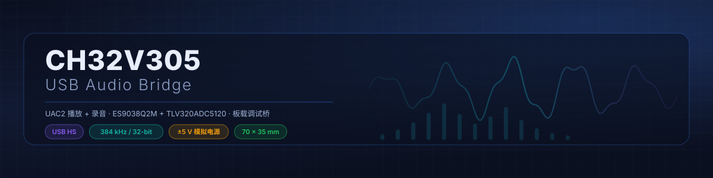
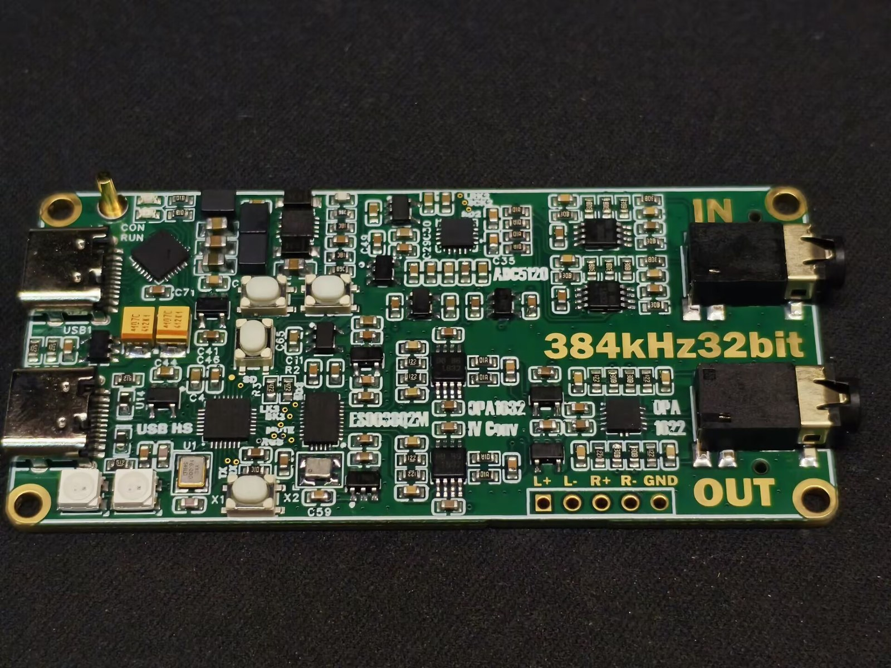
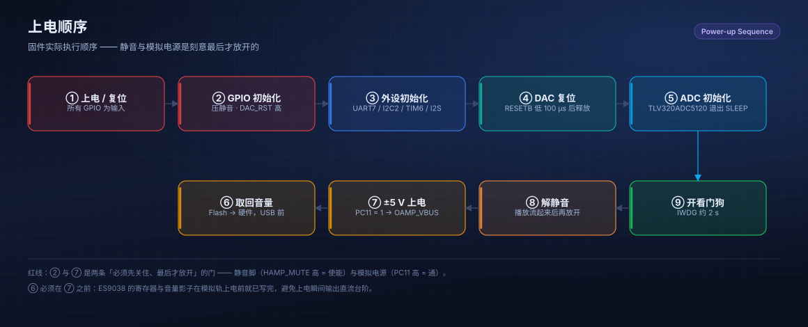
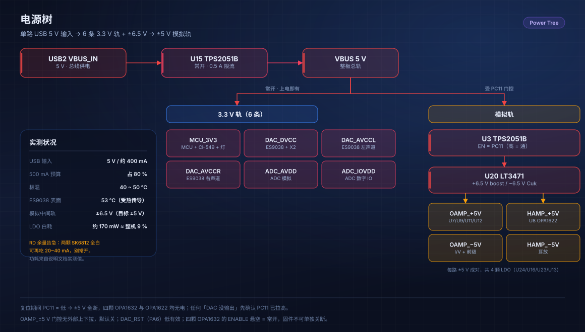
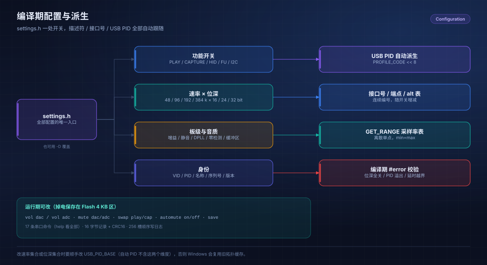

<div align="center">
  
</div>

# CH32V305 USB 音频桥

**384 kHz / 32 bit 的 USB 播放 + 录音 + HID，全部由一颗 QFN28 的 MCU 完成。**
超简洁外设，超小体积。不需要 CPLD，不需要 FPGA。

[中文](README.md) · [English](README_EN.md)


---

## 这是什么

一块基于 CH32V305GBU6 的开源 USB 音频桥，或者说，一块 384 kHz / 32 bit 播放 + 录音 + HID 的 USB 音频开发板。



- 播放、录音都是 **48 / 96 / 192 / 384 kHz**，**16 / 24 / 32 bit**，两个方向各有独立的时钟域
- **异步反馈端点**：主机按设备上报的真实消耗调整送包速率，不是硬灌
- **音量在设备侧做**：主机不再软件衰减，音量掉电存 Flash，重新插上还是那个值
- **USB HID 消费者控制**：按键发媒体键，控制电脑上的播放器
- **串口终端**：19 条命令，查状态、改参数、看芯片寄存器、换左右声道、进 ISP
- 板载 WCH-Link（CH549F）：一个 USB-C 烧写 + 串口，另一个才是音频口

## 为什么会有这个项目

上半年我做了一块 ADAU1452 的开发板，上面集成了一颗 CT7601 音频桥。当时我就在这颗芯片上下了不少功夫，属于是又爱又恨。

后来出于好奇，我用 IDA 把它的固件翻了一遍，在某个地址找到了 product string，改了个名字，Windows 里就显示成我自己的命名。再往后全网找资料，找到了 ComTrue 的数据手册，还找到了 GitHub 上同类芯片的源码。查完手册才确认：**这是一颗 51 内核的芯片，用 Keil C51 开发的**。

51 内核本身我不在意，在这个位置上它大概只负责初始化外设。真正让我受不了的是它的集成度：供电引脚一大堆，USB PHY 甚至还得外接偏置电阻。看着就像十几年前的方案。

所以当时就起了做替代方案的念头。正巧在立创社区看到一块 CH32V307 + CPLD 的声卡，就照着设计了一块 CH32V305 的开发板。目标从一开始就很明确：**对标 CT7601，甚至超过它**。它有的功能我要有，它让我难受的地方不要再有。

板子做出来之后，这个项目却没做下去——当时的能力接不住。后来我学会了用 AGENT，用它连着做完几个"以我当时的能力少说半年"的项目，觉得可以了。**虽然后来证明是我飘了。**

这个项目是我第一个用 AGENT 辅助完成的大项目，前后一个月，token 花了一百多块，人也是力竭了。但确实值得。

## 为什么是 CH32V305GBU6

QFN28，4 × 4 mm。这个封装上引出了 2 路半双工 I2S、1 路全双工 SPI、1 路 I2C、1 路全双工 UART、1 路 USB HS，最后还能剩下不少 GPIO、TIM、ADC 引脚。

很难想象 WCH 在一颗 QFN28 上塞了这么多外设。说真的，这简直像一颗专门为 USB 音频桥做的 MCU——但我在社区里没看到有人拿它做音频桥，算是块没被开发的璞玉。

更妙的是时钟。16 MHz 晶振进去，靠芯片内部几级分频和 PLL 级联：

```text
16 MHz /5 ×12 /5 ×16 = 122.88 MHz
```

122.88 MHz 恰好是 48k 系的倍数：5 分频 24.576 M，10 分频 12.288 M，20 分频 6.144 M，40 分频 3.072 M，刚好够 I2S 产生 48 / 96 / 192 / 384 kHz 立体声的 BCLK。同时 USB HS 用 HSE/4 = 4 MHz 做参考，480 MHz 也是精确的。一颗 16 MHz 晶振把两边都喂饱了。

44.1k 系我直接放弃了。我的判断是：现在哪个操作系统的音频服务没有高精度 SRC，44.1k 转 48k 在浮点域做，不会有可闻的损失；而 48k 本身比 44.1k 更普及。你肯定听过 96 kHz / 24 bit，但你大概没怎么听过 88.2 kHz / 24 bit。

顺带一提，WCH 新出的 CH32H417 有完整的全双工 SAI，还支持双频率晶振切换，其实比 V305 更适合做音频桥。有想法的可以试试。

## 这块板子

- **主控**：CH32V305GBU6，122.88 MHz，128 KB Flash / 32 KB SRAM
- **DAC**：ES9038Q2M，由板载 100 MHz 有源晶振直接供时钟，走 DPLL 异步
- **ADC**：TLV320ADC5120，两通道
- **模拟**：4 颗 OPA1632 分别做 DAC 的 I/V 和录音前级，OPA1622 做耳放
- **供电**：单根 USB 线，±5 V 由 LT3471 从 VBUS 升出来再经 LDO，MCU 用一个 GPIO 门控



实测整机 300 mA 典型、不超过 400 mA，USB 500 mA 的预算里还剩 20%。输出是差分 2 Vrms（排针）和单端不到 2 Vrms（3.5 mm），输入 2 Vrms。



**DAC 这边基本是一次成功的。** I/V 级在 LTspice 里仿真过，也和 ESS 手册里那颗 OPA1612 的方案做了对比，差距可以忽略——OPA1632 和 OPA1612 本来就是同级别的运放，用全差分做 I/V 元件还更少。唯一的短板是功耗：OPA1632 在低功耗上完全不如 OPA1612，后者算是吃到了 HIFI 手机的红利。

**ADC 那边就没这么顺。** 前级本来想直接用 OPA1632 的 VOCM 偏到 1.65 V，走直流耦合，结果实测失真很难看。改成交流耦合之后，THD 直接好了 10 dB。原因也很简单：ADC5120 的输入偏置其实是 1.480 V，不是 1.65 V，说明它内部还有一级 LDO——那我前面那颗 SGM2211 就白给了。

回环测试（-20 dBFS 输入）测到 THD+N 约 **-76 dB**。这颗 ADC 的噪声底就在 -105 dBFS 附近，DAC 的噪声完全被它盖住了，再往下测也没什么意义。手册上的 -95 dB 是 0 dB 输入条件下的数字，我没有复现到那个水平，也没有做更细的测试——**所以 THD 我只能说没测出问题，不能保证达到手册水平**。

ADC5120 说到底只是一颗低功耗 ADC，TLV320 系列的定位就是这样。它甚至都不如 PCM1840，至少 PCM1840 的 DRE 是可以四通道全开的，而 ADC5120 只能在 96 kHz 下开双通道，192 kHz 下单通道，384 kHz 下完全不能用。

## 固件功能

- **双时钟域**：播放和录音各有一个 Clock Source，各自绑定采样率，互不影响
- **反馈伺服**：TIM8 以 960 kHz 数环水位，主循环每 20 ms 调一次，SOF 中断只把缓存好的 Q16.16 值原样发出去
- **丢包补偿**：等时包丢了不是静音，是衰减重放，只要 USB 质量不是太差，听感上就不会有 pop 音
- **零电平自动静音 + 硬件音量**：主机侧不做软件衰减，DAC 内部做，掉电存 Flash
- **非线性音量曲线**：逻辑 dB 乘一个系数再量化到 0.5 dB，0 dB 仍然是最大输出
- **编解码器驱动**：ES9038Q2M、TLV320ADC5120 都调通了（ADC 那边的 DRE / PGA 也做了）。换别的芯片改一份驱动就行，欢迎社区共创
- **WS2812 状态灯**：两颗灯分别显示播放和录音的采样率（这一版比较简陋，只做了颜色区分）
- **外部电源控制**：初始化完成后引脚输出高电平
- **尾区 ISP**：flash 尾部放了一份官方 ISP（物理地址 0x0801C000，链接器里的 0x0001C000），串口 `boot` 或按键组合可以进去

关于"音量在设备侧做"，多说一句：CT7601 那套是主机先衰减再送过来，DAC 照单全收、始终保持最大增益，会有底噪。我做的是反过来——主机通过 FU 把音量写给设备，设备自己算完再写 DAC 寄存器。好处是换播放器、走 WASAPI 独占的时候音量还是同一套，不会出现"系统音量"和"播放器音量"两套打架。

## 按键、串口与灯

三个键都没有外部上拉，内部上拉，按下为低。

- **KEY1**：单击 播放/暂停，双击 静音，三击 停止，长按 关状态灯
- **KEY2**：单击 音量 −，双击 上一首，长按 关模拟电源
- **KEY3**：单击 音量 +，双击 下一首，长按 开模拟电源
- **KEY2 + KEY3** 同时按住约 1 秒：进 ISP

按键发的是 HID 消费者控制，动的是电脑上的播放器；只有 KEY2 / KEY3 的长按是本地的，直接开关 ±5 V 那一路。

### 串口终端

串口走板载 CH549F 桥出来的那个口，**115200 8N1**，回车执行，大小写不敏感。输入 `help` 可以看完整命令，`help <cmd>` 看单条用法。

查询类——不动任何状态：

| 命令 | 作用 |
|---|---|
| `info` | 采样率、音量、USB、Flash、运行时长总览 |
| `stat` | 累计计数器（不清零） |
| `play` / `cap` | 播放 / 录音路径快照（`play` 读取后清零） |
| `usb` | 端点、ISR 占用、排空情况、FU 诊断 |
| `rate` | 速率表与 alt ↔ 位深映射 |
| `fmt` | 格式落地台账（目标值 vs 硬件实际值） |
| `dac` | ES9038Q2M 寄存器快照 |
| `adc` | TLV320ADC5120 状态与增益 / 音量寄存器 |

设置类：

| 命令 | 作用 |
|---|---|
| `vol dac\|adc [dB]` | 读 / 设音量，1/256 dB 精度，例如 `vol dac -6.5` |
| `mute dac\|adc [on\|off]` | 读 / 设 FU 静音，不带参数 = 切换 |
| `automute [on\|off]` | 零电平自动静音策略（不保存） |
| `swap play\|cap [on\|off]` | 左右声道交换 |
| `fu` | FU2 / FU8 原始值与 Flash 记录 |
| `save` | 立刻把 FU 参数写进 Flash |

其他：

| 命令 | 作用 |
|---|---|
| `help [cmd]` | 命令列表 / 单条用法 |
| `hid vol up\|down`、`hid play\|pause\|next\|prev\|stop\|mute` | 发媒体键，按下后自动松开 |
| `boot [status]` | 查询尾区 ISP 是否存在 / 静音、断开 USB、复位后进入 WCH USB ISP |
| `reset` | 软复位 |

一份典型现场：

```text
> info              采样率、音量、USB 状态、Flash、运行时长
> play              播放环水位、BCLK 计数、最近包长
> dac               ES9038 寄存器快照，确认 DPLL 锁没锁
> swap play on      左右声道接反了？一条命令换回来
> save              音量 / swap 存进 Flash
```

`hid` 系列发的是媒体按键，不是直接写本机 DAC 寄存器，实际作用对象由操作系统和播放器决定。

### 指示灯

LED0 显示播放采样率，LED1 显示录音采样率，两个方向可以不一样。48k 绿、96k 黄绿、192k 青、384k 蓝。

USB 没配置好、总线挂起，或者 100 ms 收不到 SOF 的时候两颗灯会灭——关机但 USB 还供电的机器就不会一直亮着。

## 可配置项

固件的功能组合、速率位深、USB 身份、板级参数全部集中在 [`User/inc/settings.h`](User/inc/settings.h)，也可以用编译器 `-D` 覆盖。改完需要完整重新编译。



### 功能组合

```c
#define USB_PLAY_ENABLE     1
#define USB_CAPTURE_ENABLE  1
#define USB_HID_ENABLE      1
#define USB_FU_ENABLE       1
#define I2C_ENABLE          1
```

HID 独立，不依赖播放或录音。关闭音频方向会同步删除接口、终端、时钟实体、相关类请求及端点，接口号连续排列。

PID 由功能组合自动派生（`USB_PID_BASE + PROFILE_CODE << 8`），不同拓扑不会共用 Windows 的旧缓存：

| 模式 | 相对默认修改 | 自动 PID（VID = 1A86） |
|---|---|---|
| 播放 + 录音 + HID | 无 | `6005` |
| 不提供硬件 FU | `USB_FU_ENABLE=0` | `6805` |
| 完全跳过 I2C | `I2C_ENABLE=0`，FU 自动关闭 | `7805` |
| 播放 + HID | `USB_CAPTURE_ENABLE=0` | `6205` |
| 录音 + HID | `USB_PLAY_ENABLE=0` | `6105` |
| 播放 + 录音 | `USB_HID_ENABLE=0` | `6405` |
| 只有 HID | `USB_PLAY_ENABLE=0`、`USB_CAPTURE_ENABLE=0` | `6305` |

`I2C_ENABLE=0` 时不初始化 I2C 引脚和外设，不执行编解码器配置或运行期音量写入，底层总线函数直接返回失败；外部编解码器需要自己配置，或者使用合适的上电默认状态。

FU 关闭时，描述符移除 Feature Unit 并重连终端。Windows 共享播放会退回软件音量；WASAPI 独占会绕过系统软件音量，需要播放器自己调节。依据 [Microsoft EndpointVolume API](https://learn.microsoft.com/en-us/windows/win32/coreaudio/endpointvolume-api)。已实测无 FU 固件 `HardwareSupport=0`，系统共享音量能改变模拟回环幅度，而 MCU 的 FU SET 计数不增长。

### 速率与位深

```c
#define USB_RATE_96K_ENABLE  1
#define USB_RATE_192K_ENABLE 1
#define USB_RATE_384K_ENABLE 1
#define USB_PCM16_ENABLE     1
#define USB_PCM24_ENABLE     1
#define USB_PCM32_ENABLE     1
```

48k 是基础速率，上面的选项形成"共同速率集合 × 位深集合"。双流且包含 32 bit 时，Full Speed 只提供 48k，High Speed 提供全部启用的速率；关闭 32 bit 后，FS 双流可以跑到 96k/16、96k/24，单方向 FS 可以到 96k/32。

### USB 身份

`USB_VID`、`USB_PID_BASE`、`USB_PID`、`USB_PRODUCT_NAME`、`USB_MANUFACTURER_NAME`、`USB_SERIAL_PREFIX`、`USB_DEVICE_VERSION`、`FIRMWARE_VERSION` 都在 `settings.h`。

默认产品名 `CH32V305 Audio Bridge V1.0`，序列号前缀 `CH32V305GBU6-0`，实际序列号还包含 MCU UID。功能 / I2C / FU 变化会自动派生不同 PID，避免不同拓扑共用 Windows 缓存；显式定义 `USB_PID` 可以覆盖派生值。

速率集合或位深集合改变时，需要自己更新 `USB_PID_BASE` 或序列号前缀——自动 PID 不包含这两个维度。不要为了正常 HS / FS 切换去改身份。

### 板级与运行设置

| 设置 | 默认 | 含义 |
|---|---|---|
| `DAC_OUTPUT_CROSS` | 1 | DAC1←CH2，DAC2←CH1 |
| `PLAY_SWAP_DEFAULT` / `CAPTURE_SWAP_DEFAULT` | 1 / 0 | 无 Flash 记录时的软件左右声道交换 |
| `ADC_DEFAULT_GAIN_DB` | 12 | ADC PGA 最大增益，单位 dB |
| `ADC_DRE_ENABLE` | 1 | 按录音速率：48/96k 开、192/384k 关；AGC/DRC 关闭 |
| `ADC_DRE_CONFIG` | 0x4B | −36 dB 触发，最多 +24 dB 附加增益 |
| `DAC_SOFT_MUTE_EN` | 1 | 使用 DAC 数字软静音 |
| `AMP_MUTE_GPIO_EN` | 0 | 保留 OPA1622 GPIO 静音开关；实测切换仍有明显瞬态，默认关闭 |
| `PLAY_UNMUTE_DELAY_US` | 10000 | 播放解除自动静音的软件延时 |
| `ZERO_DETECT_ENABLE` | 1 | 零电平自动静音初始策略 |
| `FU_SAVE_ON_CHANGE` | 1 | 两路均空闲后延迟保存 |

## 开发中踩的坑

前后调了一个月。板子没到之前用面包板和模块调，板子到了接着调。起点是那块 CH32V307 + CPLD 的开源项目，改到现在亲妈来了也认不出来：手动重构过，也让 AI 重构过——原先那套架构单播放能跑，一双流就不行。

- **播放和录音的时钟分不开**：Windows 的 UAC2 驱动不支持用 Clock Selector 切换时钟源，但允许播放和录音两条路径各自直接绑一个独立的 Clock Source。AGENT 一开始认定 UAC2 只支持单时钟源，其实是低估了；最后照抄 CT7601 的双时钟源、无 Clock Selector 拓扑，胜芯微那边也验证过这套结构能工作。
- **枚举要一分钟，还会拖垮资源管理器**：原始固件开了硬件 INTBUSY 代理，只要中断标志没清就自动对所有中断传输和控制请求回 NAK，Windows 驱动每个请求都超时退出。HID 更隐蔽——主机会把等时传输和 HID 轮询排在同一个微帧里且 HID 在后面，等时没处理完 HID 就被 NAK 掉，所有 HID 都发不出去。这个问题调了几天。
- **音频被 8 kHz 调制**：AI 把 UAC 的反馈计算放进了 SOF 中断，1 ms 才算一次反馈值，这一帧的等时包直接被丢掉，于是 125 µs 的微帧变成了 8 kHz 调制。后来让 GPT 把整个中断状态机重写：中断只做派发、不直接搬 DMA，改完等时包中断 30 µs 内跑完，CPU 中断占用不超过 20%。
- **换采样率之后全是白噪声**：原项目在 USB 中断里直接停 DMA、重新初始化 I2S、切分频、再启 DMA，而且没清环、没重置 DMA 指针，切换时指针和 PCM 帧错位，低位数据被当成了高位。改成中断只置标志、主循环完整重置后，再没复现过。
- **双流同时打开必有一路收不到数据**：把 INTBUSY 修掉之后问题还在，说明是中断状态机的结构性问题，最后还是靠上面那次重构解决的。

完整的调试记录（几十份日志、抓包、测试数据）放在硬件工程页，这里不展开。

## 为什么最后还是买了 USB 分析仪

回头看，这个项目里真正难的从来不是写代码，而是**看不见**：主机发了什么、设备回没回、中断轮询有没有送出去，全靠猜。

五个坑里，前三个——双时钟域、INTBUSY 导致枚举拖一分钟、8 kHz 调制——如果有台 USB 分析仪，都是当场就能出结果的。但我还是犹豫了很久才买。

事实是买 USB 分析仪完全不亏。它几乎瞬间定位了所有 USB 问题：MCU 到底有没有回答主机的控制请求，中断轮询到底有没有把数据送出去，抓包一看瞬间破局。这些问题我猜了几天，拿到分析仪之后几乎一天就全调好了。

**搞 USB 开发，USB 分析仪基本是必备的**——它能把"只能靠猜"的东西变成"可以实际测量"的东西。仅靠电脑也有软件抓包（USBPcap 之类），但软件抓包只知道主机发了什么、收到了什么；设备到底是接受了还是拒绝了，一概不知。

顺带说一下逻辑分析仪和 USB 分析仪的区别：逻辑分析仪抓的是 TTL 信号，测不了 USB 高速——USB 高速是 480 Mbps 的低压差分信号，没有逻辑分析仪能直接测，而且探头挂上去会影响差分阻抗，大概率直接导致无法枚举，只能拿来测全速。**能不能测高速，就是这两类工具最大的区别。** 我手上这台是 FPGA + USB3343 PHY 的方案，可以测高速。

可以说，如果没有 USB 分析仪，这个项目大概率还要再拖很久。

## 编译与烧录

**直接烧 `firmware/first_install_128k.bin` 就行**——这是整合了 APP + ISP 的完整 128 KB 镜像，用 WCH-Link / SDI 烧进去即可。不想 clone 整个仓库的话，同一个镜像也挂在 [Releases](https://github.com/lishuo4096/usb-audio-ch32v305/releases) 里。

后续升级只覆盖应用区：烧 `firmware/app_only.bin` 或 `firmware/USBAudio.hex`，也可以用串口 `boot` 进 ISP，再用 WCHISPTool 下载。进了尾区 ISP 之后**不要**下完整的 128 KB 镜像，也**不要**整片擦除，那会把 ISP 一起擦掉。

编译需要把仓库 clone 到本地，用 MounRiver Studio 打开工程（`File → Import → Existing Project`）直接编译，工具链是 `riscv-wch-elf-gcc`：

```text
-march=rv32imac_xw -mabi=ilp32 -O1
```

Flash 128 KB / SRAM 32 KB。应用区 112 KB，紧跟一块 4 KB 的参数区（`.fustore`），尾部 16 KB 留给 ISP——`Link.ld` 的 `LENGTH = 112K` 就是为了守住这条线。当前镜像约 68 KB，SRAM 用到约 29 KB，栈 2 KB，加功能之前先看 `.map`。

## 已知限制

- **没有 44.1k 系**。这个取舍我认为值得，接受不了的话只能等 H417 版本了
- **THD 没有详细测**，只有回环那一个点
- **MUTE 输出这一版没开**（`AMP_MUTE_GPIO_EN=0`），因为 OPA1622 没有防 pop
- **指示灯很简陋**，只是按采样率换颜色，没有 SOF 就关灯
- **尾区 ISP 不是"上电先跑的恢复型一级 bootloader"**，应用被擦坏了还是得用 SDI 救
- **升级可能清掉 Flash 里的音量 / 静音参数**，记录区在应用区内，不保证跨版本保留
- **VID 用的是 1A86**（WCH 的），自己玩没问题，要量产得自己申请
- 板上有调试痕迹，**丝印标 NC 的位号不要焊**

## 硬件工程
https://oshwhub.com/lishuo123/project_ppnjliwl
原理图、PCB、BOM 和完整的开发记录（几十份调试日志、抓包、测试数据）在立创开源硬件平台单独发布。这个仓库只放固件和一份简短说明。

## 致谢

- **WCH（沁恒）**：CH32V305、标准外设库、USB HS 设备栈示例
- **[LoveLonelyTime / USBAudioToI2S](https://github.com/LoveLonelyTime/USBAudioToI2S)**：这个项目是从他那套 CH32V307 + CPLD 的方案改出来的（Apache-2.0）

## 许可

- **固件**：MIT，见 [LICENSE](LICENSE)。含 USBAudioToI2S 的 Apache-2.0 衍生部分，原始版权声明保留
- **硬件**：CERN-OHL-P-2.0（见硬件工程）
- **文档与图片**：CC BY 4.0
