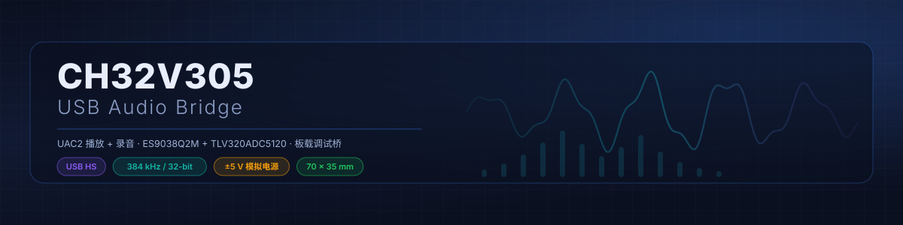
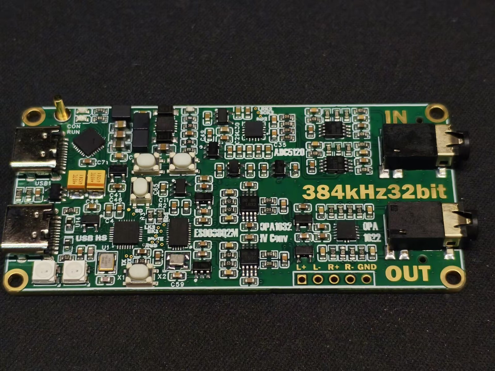

<div align="center">
  
</div>

# CH32V305 USB Audio Bridge

**384 kHz / 32-bit USB playback + capture + HID, all on a single QFN28 MCU.**
Tiny footprint, minimal external parts. No CPLD, no FPGA.

[中文](README.md) · [English](README_EN.md)


---

## What is it

An open-source USB audio bridge built on the CH32V305GBU6 — or, if you prefer, a 384 kHz / 32-bit USB audio dev board with playback, capture and HID.



- **48 / 96 / 192 / 384 kHz** playback and capture, **16 / 24 / 32-bit**, with independent clock domains in both directions
- **Asynchronous feedback endpoint**: the host paces packets by the device's real consumption instead of guessing
- **Volume is handled on the device**: no host-side software attenuation, stored in flash, and the host reads back the local value
- **USB HID consumer control**: the keys send media keys to whatever player is running on the host
- **Serial console**: 19 commands for status, parameters, codec registers, L/R swap and entering ISP
- Onboard WCH-Link (CH549F): one USB-C for flashing plus a UART, the other is the actual audio port

## Why this project exists

Earlier this year I built an ADAU1452 dev board with a CT7601 audio bridge on it. I spent a lot of time with that chip — loved it and hated it at the same time.

Out of curiosity I opened its firmware in IDA, found the product string somewhere in the image, patched it, and Windows started showing my own device name. Then I went looking for documentation and found ComTrue's datasheet, plus source code for similar chips on GitHub. The datasheet confirmed it: **an 8051 core, developed with Keil C51**.

The 8051 core itself doesn't bother me — at that position it only has to initialize peripherals. What I couldn't stand was the level of integration: a pile of supply pins, and a USB PHY that still needs an external bias resistor. It looks like a design from a decade ago.

That's when the idea of a replacement started. I happened to find a CH32V307 + CPLD sound card project on OSHWHub and designed a CH32V305 board following that idea. The goal was clear from day one: **match the CT7601, then beat it** — everything it can do, plus none of the things that annoyed me.

The board came back, but the project stalled: my skills at the time couldn't carry it. Later I learned to work with agents, and after finishing a few projects that would have taken me "at least half a year" on my own, I thought I was ready. **Turned out I was overconfident.**

This is the first large project I completed with agent assistance. A month of work, more than 100 RMB of tokens, and I was completely drained by the end. Worth it.

## Why the CH32V305GBU6

QFN28, 4 × 4 mm. In that package it exposes two half-duplex I2S ports, one full-duplex SPI, one I2C, one full-duplex UART, one USB HS port — and still leaves a decent number of GPIO, TIM and ADC pins.

It's hard to believe WCH fit that much into a QFN28. Honestly it feels like an MCU designed specifically for a USB audio bridge — yet I haven't seen anyone in the community use it that way. An unexplored gem.

The clocking is the really nice part. Feed it 16 MHz and a few internal dividers and cascaded PLLs give you:

```text
16 MHz /5 ×12 /5 ×16 = 122.88 MHz
```

122.88 MHz is an exact multiple of the 48k family: divide by 5 for 24.576 M, by 10 for 12.288 M, by 20 for 6.144 M, by 40 for 3.072 M — exactly what I2S needs to produce BCLK for 48 / 96 / 192 / 384 kHz stereo. Meanwhile USB HS takes HSE/4 = 4 MHz as its reference, so 480 MHz is exact too. One 16 MHz crystal feeds both sides.

The 44.1k family is deliberately unsupported. My reasoning: every modern OS audio stack has a high-quality resampler, and 44.1k → 48k in the float domain is inaudible; 48k is also more common than 44.1k. You've definitely heard of 96 kHz / 24-bit; you probably haven't heard much about 88.2 kHz / 24-bit.

As an aside, WCH's newer CH32H417 has a complete full-duplex SAI and supports switching between two crystal frequencies, which actually makes it a better fit for an audio bridge. If you're thinking about it, go for it.

## The board

- **MCU**: CH32V305GBU6 at 122.88 MHz, 128 KB flash / 32 KB SRAM
- **DAC**: ES9038Q2M, clocked directly by an onboard 100 MHz oscillator, running DPLL asynchronous
- **ADC**: TLV320ADC5120, two channels
- **Analog**: four OPA1632 (DAC I/V and capture preamp), OPA1622 headphone amp
- **Power**: single USB cable; ±5 V is generated from VBUS by an LT3471 through LDOs, gated by one GPIO

Measured draw is 300 mA typical, under 400 mA — about 80% of the 500 mA USB budget. Output is 2 Vrms differential (header) and just under 2 Vrms single-ended (3.5 mm); input is 2 Vrms.

**The DAC side worked almost first try.** I simulated the I/V stage in LTspice and compared it against the OPA1612 reference design in the ESS datasheet — the difference is negligible. OPA1632 and OPA1612 are in the same class, and a fully-differential I/V needs fewer parts. The only downside is power: OPA1632 is clearly worse than OPA1612 at low quiescent current, and the latter benefited from the HiFi-phone era.

**The ADC side was not so smooth.** I originally wanted to bias the preamp to 1.65 V through the OPA1632 VOCM pin and run DC-coupled; the measured distortion was ugly. Switching to AC coupling improved THD by 10 dB. The reason is simple: the ADC5120's input bias is actually 1.480 V, not 1.65 V, which means it has an internal LDO — so the SGM2211 in front of it was wasted.

Loopback at -20 dBFS gives THD+N around **-76 dB**. The ADC noise floor is about -105 dBFS, so the DAC's noise is completely buried; measuring further is pointless. The -95 dB in the datasheet is at 0 dBFS input, and I didn't reproduce that, nor did I run a fuller test suite — **so all I can say is that I found no problem, not that it meets the datasheet**.

The ADC5120 is, after all, a low-power ADC from the TLV320 family. It isn't even as good as a PCM1840 — at least the PCM1840 can run DRE on all four channels, while the ADC5120 only supports two channels at 96 kHz, one at 192 kHz, and none at 384 kHz.

## Firmware features

- **Dual clock domains**: playback and capture each have their own Clock Source and sample rate
- **Feedback servo**: TIM8 counts ring occupancy at 960 kHz, the main loop adjusts it every 20 ms, and the SOF interrupt just replays the cached Q16.16 value
- **Packet loss concealment**: a missing isochronous packet is faded out rather than muted, so with a reasonable USB link you don't hear a pop
- **Zero-detect auto-mute + hardware volume**: no host-side attenuation, the DAC does it, and the value survives power loss in flash
- **Non-linear volume curve**: logical dB is scaled and then quantized to 0.5 dB, with 0 dB still selecting full output
- **Codec drivers**: ES9038Q2M and TLV320ADC5120 (including ADC DRE / PGA). Swapping in another codec means writing one driver — contributions welcome
- **WS2812 status LEDs**: two LEDs show playback and capture sample rates (basic in this version, color only)
- **External power control**: the analog rail is enabled only after init, by driving a GPIO high
- **Tail ISP**: an official ISP image sits at the end of flash (physical 0x0801C000, linker alias 0x0001C000); enter it via the `boot` command or a key combo

A note on device-side volume: the CT7601 approach has the host attenuate first and the DAC run at full gain all the time, which raises the noise floor. I did the opposite — the host writes volume through the FU, the device computes it and writes the DAC registers itself. The benefit is that switching players or using WASAPI exclusive keeps one consistent volume, instead of "system volume" and "player volume" fighting each other.

## Keys, console and LEDs

None of the three keys has an external pull-up; internal pull-ups are used, pressed reads low.

- **KEY1**: click play/pause, double-click mute, triple-click stop, long-press LEDs off
- **KEY2**: click volume −, double-click previous track, long-press analog power off
- **KEY3**: click volume +, double-click next track, long-press analog power on
- **KEY2 + KEY3** held for about 1 s: enter ISP

The keys send HID consumer reports to the host player. Only the KEY2 / KEY3 long-press is local — it switches the ±5 V analog rail.

### Serial console

The UART comes out of the onboard CH549F bridge: **115200 8N1**, Enter to run, case-insensitive. `help` lists everything, `help <cmd>` shows one command.

Read-only:

| Command | Purpose |
|---|---|
| `info` | sample rate, volume, USB, flash, uptime |
| `stat` | cumulative counters (never cleared) |
| `play` / `cap` | playback / capture snapshot (`play` clears on read) |
| `usb` | endpoints, ISR load, drain state, FU diagnostics |
| `rate` | rate table and alt ↔ bit-depth map |
| `fmt` | format landing ledger (requested vs. hardware) |
| `dac` | ES9038Q2M register snapshot |
| `adc` | TLV320ADC5120 status and gain/volume registers |

Settings:

| Command | Purpose |
|---|---|
| `vol dac\|adc [dB]` | read/set volume at 1/256 dB, e.g. `vol dac -6.5` |
| `mute dac\|adc [on\|off]` | read/set FU mute; no argument toggles |
| `automute [on\|off]` | zero-detect mute policy (not saved) |
| `swap play\|cap [on\|off]` | swap left/right |
| `fu` | raw FU2 / FU8 values and the flash record |
| `save` | write FU parameters to flash now |

Other:

| Command | Purpose |
|---|---|
| `help [cmd]` | command list / per-command usage |
| `hid vol up\|down`, `hid play\|pause\|next\|prev\|stop\|mute` | send a media key, auto-released |
| `boot [status]` | query the tail ISP / mute, detach USB and reboot into the WCH USB ISP |
| `reset` | soft reset |

A typical debugging session:

```text
> info              sample rate, volume, USB state, flash, uptime
> play              ring occupancy, BCLK count, last packet size
> dac               ES9038 register snapshot, check DPLL lock
> swap play on      channels reversed? one command fixes it
> save              persist volume / swap to flash
```

`hid` sends media keys — it does not write the local DAC registers. What actually happens is up to the OS and the player.

### LEDs

LED0 shows the playback rate, LED1 the capture rate; the two directions can differ. 48k green, 96k yellow-green, 192k cyan, 384k blue.

If USB isn't configured, the bus is suspended, or no SOF arrives for about 100 ms, both LEDs turn off — so a machine that keeps USB powered after shutdown doesn't leave them lit.

## Configuration

Everything — feature set, rates and bit depths, USB identity, board-level parameters — lives in [`User/inc/settings.h`](User/inc/settings.h), and every macro can be overridden with `-D`. A full rebuild is required after changing them.

### Feature set

```c
#define USB_PLAY_ENABLE     1
#define USB_CAPTURE_ENABLE  1
#define USB_HID_ENABLE      1
#define USB_FU_ENABLE       1
#define I2C_ENABLE          1
```

HID is independent of playback and capture. Disabling an audio direction removes its interface, terminal, clock entity, class requests and endpoints; interface numbers are renumbered automatically.

The PID is derived from the feature set (`USB_PID_BASE + PROFILE_CODE << 8`), so different topologies don't share a stale Windows cache:

| Mode | Change | Derived PID (VID = 1A86) |
|---|---|---|
| Playback + capture + HID | none | `6005` |
| No hardware FU | `USB_FU_ENABLE=0` | `6805` |
| Skip I2C entirely | `I2C_ENABLE=0` (FU follows) | `7805` |
| Playback + HID | `USB_CAPTURE_ENABLE=0` | `6205` |
| Capture + HID | `USB_PLAY_ENABLE=0` | `6105` |
| Playback + capture | `USB_HID_ENABLE=0` | `6405` |
| HID only | both audio directions off | `6305` |

With `I2C_ENABLE=0` the pins and peripheral are never initialized, codec setup and runtime volume writes are skipped, and the bus functions return failure. An external codec then needs its own configuration or suitable power-on defaults.

With FU disabled the descriptor drops the Feature Unit and reconnects the terminal. Windows shared-mode playback falls back to software volume; WASAPI exclusive bypasses it and the player must handle volume. See the [Microsoft EndpointVolume API](https://learn.microsoft.com/en-us/windows/win32/coreaudio/endpointvolume-api). Measured: with no FU, `HardwareSupport=0`, shared-mode volume still changes the analog loopback level, and the MCU's FU SET counter does not move.

### Rates and bit depths

```c
#define USB_RATE_96K_ENABLE  1
#define USB_RATE_192K_ENABLE 1
#define USB_RATE_384K_ENABLE 1
#define USB_PCM16_ENABLE     1
#define USB_PCM24_ENABLE     1
#define USB_PCM32_ENABLE     1
```

48k is always the baseline. The flags form a common rate set × bit-depth set. With two streams and 32-bit enabled, Full Speed offers 48k only while High Speed offers every enabled rate; disable 32-bit and FS dual-stream can reach 96k/16 and 96k/24, or 96k/32 in a single direction.

### USB identity

`USB_VID`, `USB_PID_BASE`, `USB_PID`, `USB_PRODUCT_NAME`, `USB_MANUFACTURER_NAME`, `USB_SERIAL_PREFIX`, `USB_DEVICE_VERSION` and `FIRMWARE_VERSION` all live in `settings.h`.

Default product string is `CH32V305 Audio Bridge V1.0`, serial prefix `CH32V305GBU6-0`, and the actual serial includes the MCU UID. Changing features, I2C or FU automatically derives a different PID so Windows caches don't collide; define `USB_PID` explicitly to override.

Changing the rate or bit-depth set does **not** change the derived PID — bump `USB_PID_BASE` or the serial prefix yourself. Don't change identity just to switch between HS and FS.

### Board and runtime settings

| Setting | Default | Meaning |
|---|---|---|
| `DAC_OUTPUT_CROSS` | 1 | DAC1←CH2, DAC2←CH1 |
| `PLAY_SWAP_DEFAULT` / `CAPTURE_SWAP_DEFAULT` | 1 / 0 | software L/R swap when flash has no record |
| `ADC_DEFAULT_GAIN_DB` | 12 | ADC PGA max gain, dB |
| `ADC_DRE_ENABLE` | 1 | by capture rate: on at 48/96k, off at 192/384k; AGC/DRC off |
| `ADC_DRE_CONFIG` | 0x4B | -36 dB trigger, up to +24 dB additional gain |
| `DAC_SOFT_MUTE_EN` | 1 | use the DAC's digital soft mute |
| `AMP_MUTE_GPIO_EN` | 0 | keep the OPA1622 GPIO mute; still an audible transient, off by default |
| `PLAY_UNMUTE_DELAY_US` | 10000 | software delay before unmute on playback |
| `ZERO_DETECT_ENABLE` | 1 | initial zero-detect auto-mute policy |
| `FU_SAVE_ON_CHANGE` | 1 | deferred save once both directions are idle |

## Development war stories

A month of work: breadboards and modules before the PCB arrived, then the real board.

The starting point was that CH32V307 + CPLD open-source project, but by now even its author wouldn't recognize it — I refactored it by hand and then had an AI refactor it again. The original architecture could run a single playback stream and fell apart the moment a second stream appeared.

- **Playback and capture clocks couldn't be separated.** Windows' UAC2 driver doesn't support switching clock sources with a Clock Selector, but it does allow each path to bind its own independent Clock Source. The agent initially assumed UAC2 only supports one clock source; that was an underestimate. I ended up copying the CT7601 descriptor — two clock sources, no Clock Selector — and the topology was later verified in testing as well.
- **Enumeration took a minute and dragged down Explorer.** The original firmware enabled the hardware INTBUSY proxy: until the interrupt flag is cleared, it auto-NAKs every interrupt transfer and control request, so Windows times out on each one. HID was the same root cause but sneakier — the host packs isochronous transfers and HID polling into the same microframe with HID last, so an unfinished isochronous transfer NAKs the HID poll. That one took days.
- **Audio modulated by 8 kHz.** The AI had put the UAC feedback calculation in the SOF interrupt, computing it once per millisecond, which dropped that frame's isochronous packet — turning the 125 µs microframe into an 8 kHz modulation. GPT rewrote the whole interrupt state machine: the ISR only dispatches, it never moves DMA. The isochronous handler now finishes in 30 µs, with CPU interrupt load under 20%.
- **White noise after a sample-rate change.** The original code stopped DMA, re-initialized I2S, changed the divider and restarted DMA right inside the USB interrupt, and it never cleared the ring or reset the DMA pointer — so the pointer and the PCM frame fell out of alignment and low words were played as high words. Moving to "ISR sets a flag, main loop performs a full reset" fixed it for good.
- **Two isochronous streams could not run together.** One direction always received nothing. It survived the INTBUSY fix, so it was structural, and the same rewrite solved it.

The full debugging trail — dozens of logs, captures and measurements — lives on the hardware project page, not here.

## Why I eventually bought a USB analyzer

Looking back, the hard part of this project was never writing code. It was **not being able to see**: what the host sent, whether the device answered, whether the interrupt endpoint actually transmitted anything. All guesswork.

Three of the five problems above would have been solved on the spot with a USB analyzer. Still, I hesitated for a long time before buying one.

It was absolutely worth it. It located every USB problem almost instantly: whether the MCU answered a control request, whether the interrupt endpoint ever sent data — one capture and the case was closed. What took me days of guessing took about a day with the analyzer in hand.

**For USB development, a USB analyzer is essentially mandatory.** It turns "you can only guess" into "you can actually measure". A software capture (USBPcap and friends) only tells you what the host sent and received; whether the device accepted or rejected it is invisible.

For comparison: a logic analyzer captures TTL-level signals and cannot see USB High Speed — HS is 480 Mbps low-voltage differential, no logic analyzer can sample it directly, and probing it disturbs the differential impedance enough that the device often fails to enumerate. It can only be used at Full Speed. **Being able to see High Speed is the fundamental difference between the two tools.** Mine is an FPGA + USB3343 PHY design, which does handle HS.

Without it, this project would probably still be unfinished.

## Build and flash

**Just flash `firmware/first_install_128k.bin`** — it is a complete 128 KB image containing both the application and the ISP, written with WCH-Link / SDI.

For updates, write only the application region: `firmware/app_only.bin` or `firmware/USBAudio.hex`, or use the `boot` command to enter the ISP and download with WCHISPTool. Once inside the tail ISP, **do not** download the full 128 KB image and **do not** chip-erase — that wipes the ISP itself.

To build, clone the repo and open the project in MounRiver Studio (`File → Import → Existing Project`). The toolchain is `riscv-wch-elf-gcc`:

```text
-march=rv32imac_xw -mabi=ilp32 -O1
```

Flash is 128 KB, SRAM 32 KB. The application region is 112 KB, followed by a 4 KB parameter region (`.fustore`); the last 16 KB belongs to the ISP, which is what `LENGTH = 112K` in `Link.ld` protects. The current image is about 68 KB, SRAM usage about 29 KB with a 2 KB stack — check the `.map` before adding features.

## Known limitations

- **No 44.1k family.** I think the tradeoff is worth it; if you disagree, you'll have to wait for an H417 version
- **THD was not characterized in detail** — only the loopback point
- **MUTE output is disabled in this build** (`AMP_MUTE_GPIO_EN=0`) because the OPA1622 has no pop suppression
- **LEDs are minimal** — color by sample rate only, off when there is no SOF
- **The tail ISP is not a recovery bootloader that runs before the application.** If the app is corrupted, you still need SDI to rescue it
- **Upgrades may clear the stored volume / mute parameters**; the record lives inside the application region and is not guaranteed across versions
- **VID is 1A86** (WCH's). Fine for personal use; get your own for a product
- The board has rework marks — **do not populate parts marked NC**

## Hardware

Schematics, PCB, BOM and the complete development record (dozens of debug logs, captures, measurements) are published separately on the OSHWHub hardware project. This repository holds the firmware and this short introduction only.

## Credits

- **WCH**: CH32V305, the standard peripheral library and the USB HS device stack examples
- **[LoveLonelyTime / USBAudioToI2S](https://github.com/LoveLonelyTime/USBAudioToI2S)**: this project grew out of their CH32V307 + CPLD design (Apache-2.0)

## License

- **Firmware**: MIT, see [LICENSE](LICENSE). Includes Apache-2.0 derived portions from USBAudioToI2S; original notices are retained
- **Hardware**: CERN-OHL-P-2.0 (see the hardware project)
- **Documentation and images**: CC BY 4.0
